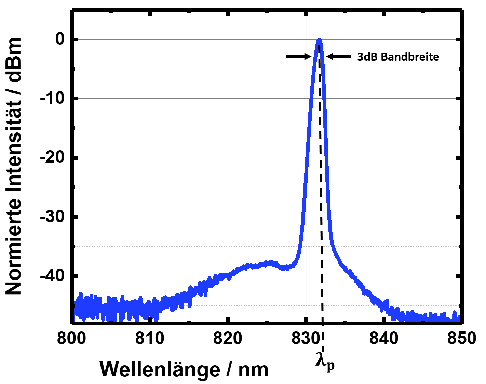
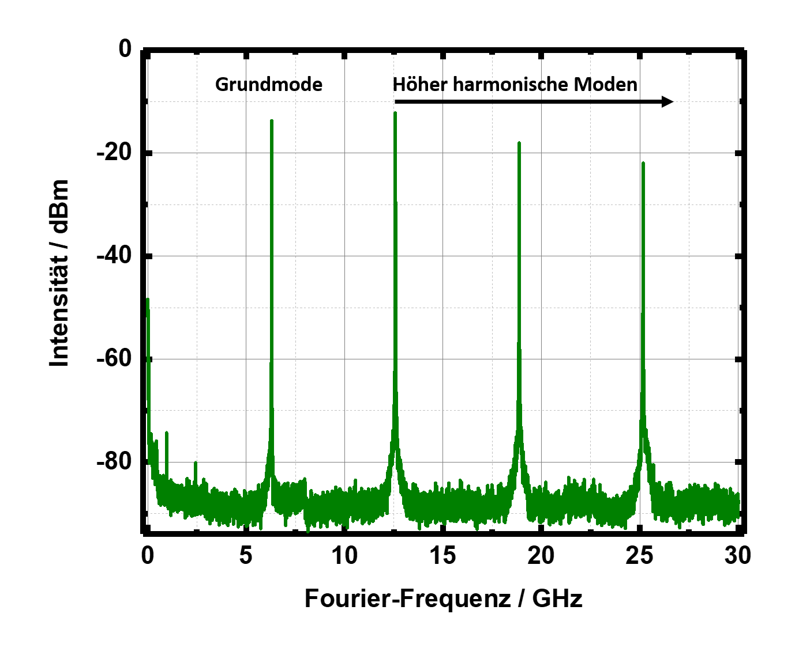
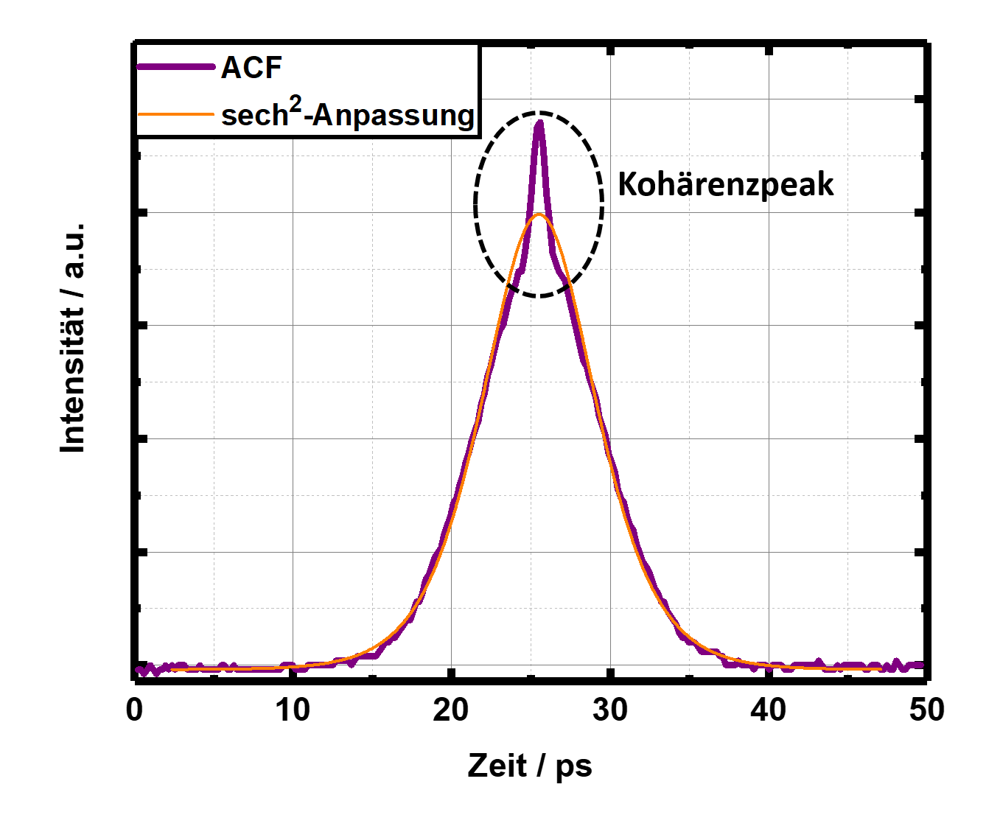

## The Laser Diode Analyzer
This Python-based analysis tool automates the evaluation of raw measurement data obtained during the investigation of pulsed laser diodes.

**Note**: This code was developed between 2021 and 2023 without AI assistance.

### This Repository

This repository contains two directories. In the directory `small_testdataset`, you will find a typical example of a raw dataset obtained during the electro-optical investigation of a pulsed laser diode.
The dataset contains measurements of an intensity autocorrelation (ACF), the current-voltage-power characteristics of the laser diode (PUI), the optical spectrum (S), and the radio-frequency spectrum of the laser diode (RF) over different frequency spans.

#### Analyze the data
In the directory `LaserDiodeAnalyzer`, you will find the program for analyzing the test dataset.
To start the analysis, run the script `gui_main.py`. A graphical user interface (GUI) will open, allowing you to select multiple folders containing the raw measurement datasets using the Browse button.
Using the checkboxes, you can select which types of measurement data you want to analyze (PUI, ACF, optische Spektren, Rf Spektren). 
Press the **"Auswertung Starten"** button to start the analysis.

## Description of what this Program does 

### Background to the experimental measurement
First, we apply a constant voltage to the absorber of the laser diode. To investigate the electro-optical characteristics of the laser diode, we apply an excitation current to the active region and sweep this current. For each current step, we measure the optical output power, the optical spectrum, the intensity autocorrelation of the light pulses, and the radio-frequency spectrum over different frequency spans.

### The Results
When the analysis is complete, you will find a directory called `Auswertung` inside the directory containing the raw measurement data. Depending on which checkboxes you selected, you will find the corresponding analysis results.

If you run the full analysis with all checkboxes selected, you will get the following results:

1. **The directories `ACF`, `Opt`, `PUI` and `RF`** 
    These directories contain the analysis results for the different measurements.

2. **A large number of CSV files** 
    These files contain the most relevant results of the analyses for the different measurements.

In the following sections, I will explain the physical and mathematical background of these results for the different measurements and indicate the corresponding files in which these results can be found.

**Note:** The results are obtained from measurement data and not from theoretical simulations. Therefore, this program does not generate graphs of the data. The reason is that the graphs usually need to be individually modified because each diode has its own characteristics. Therefore, a plotting program such as Origin is essential for visualizing the data appropriately.

### The optical spectrum 
The optical spectrum is measured using a spectrum analyzer. The spectrum analyzer measures the light intensity (in dBm) over a specified wavelength range.

The following figure shows a typical normalized optical spectrum of a pulsed laser diode. The characteristic quantities, namely the peak wavelength $\lambda_p$ and the 3 dB bandwidth, are marked.

  

For every measured spectrum (reminder: we sweep the excitation current and measure a spectrum at each current step), the program determines the peak wavelength and the 3 dB bandwidth using the following procedure:

1. **Convert the raw data into a CSV file** 
    First, the program converts the raw data into a CSV file and removes all unnecessary information contained in the raw `.dat` file. This file can be found in the directory `Auswertung/Opt/.../`under the name `opt_cleanRawData`.

    In a second step, the program reshapes the data and creates another CSV file named `opt_x.xxV_PlotDaten`. In column A, you will find the wavelength. The first row contains the excitation current, and below each excitation current, you will find the measured (unnormalized) intensity at the corresponding wavelength. 

2. **Normalize the spectra to the maximum peak intensity** 
    To normalize the spectra, the program first determines the highest peak intensity among all measured spectra. This peak intensity is then subtracted from each measured spectrum, resulting in a relative intensity scale referenced to the maximum peak intensity. The normalized spectra are saved in the CSV file `opt_normiert_x.xxV_PlotDaten` in the directory `Auswertung/Opt/.../`. 
    
3. **Estimation of the peak wavelength** 
    To estimate the peak wavelength, the program determines the wavelength corresponding to the highest intensity in each spectrum using the unnormalized data from `opt_x.xxV_PlotDaten`. The peak wavelength for each measured spectrum is then saved in the CSV file `opt_peak_Wellenlaenge` in the directory `Auswertung/`. 

4. **Estimation of the 3 dB bandwidth** 
    The 3 dB bandwidth is the wavelength range between the two wavelengths at which the intensity has decreased by 3 dB relative to the peak intensity.   
    To estimate the 3 dB bandwidth, the program first divides the spectrum at the peak wavelength into a left and a right part. It then subtracts 3 dB from the peak intensity to determine the target intensity corresponding to the 3 dB level.   
    For both the left and the right part of the spectrum, the program searches for the measured wavelength whose intensity is closest to this target intensity. The two neighboring data points around this wavelength are then used to perform a linear fit. From this fit, the program determines the slope and y-intercept of the line and uses them to estimate the wavelength at which the spectrum exactly reaches the 3 dB level.   
    This procedure is performed independently for the left and the right sides of the spectrum, resulting in two 3 dB wavelengths. The 3 dB bandwidth is then calculated as the difference between these two wavelengths:  
    $$\Delta\lambda_{3,\mathrm{dB}} = \lambda_{3,\mathrm{dB,right}} - \lambda_{3,\mathrm{dB,left}}$$  
    These estimated 3 dB bandwidths of all measured spectra are saved in the CSV file `opt_3dB_Bandbreite` in the directory `Auswertung/`.
    

### The Radio Frequency Spectrum

The radio frequency (RF) spectrum is measured using a swept spectrum analyzer. The RF spectrum analyzer measures the signal intensity (in dBm) over a specified frequency range. The following figure shows a typical overview spectrum with a frequency span of 30 GHz.

  

The test dataset contains three RF spectra measured over different frequency spans: \
$1,0\cdot 10^{8}$ Hz; $6,3\cdot 10^{9}$ Hz and $3,0\cdot 10^{10}$ Hz. \
During the measurements, the exciation current was swept from 190 mA to 700 mA in steps of 10 mA. A spectrum was acquired for each frequency span at every current step.

1. **Convert the raw data into CSV files**  
    First, the program converts the raw data from the three RF measurements into CSV files and removes all unnecessary information contained in the raw `.dat` files. These cleaned files are saved in the directory `Auswertung/Rf/...` under the name `Rf_cleanRawData`.\
    The program then reshapes the data and creates additional CSV files named `Rf_PlotDaten_x.xxV_dBm`. The first row contains the excitation current. For each excitation current, the file contains the corresponding frequency values and the measured RF power (in dBm) at each frequency point.\
    To perform a Lorentzian fit of the frequency peaks, the RF power must also be converted from dBm to mW. The program therefore creates additional files containing the converted data.\
    For the measurement with a frequency span of 30 GHz, the files `Rf_PlotDaten_x.xxV_3.000e+10Hz_dBm` and `Rf_PlotDaten_x.xxV_3.000e+10Hz_mW` are saved in the directory `Auswertung`. For the other measurements, the corresponding `PlotDaten` files are saved in their respective subdirectories under `Auswertung/Rf/...`.
 
2. **Analysis of the Repetition Frequency Peak**  
    The first frequency peak in the spectra is also called the repetition frequency. For the investigated laser diode, this frequency is approximately 6,3 GHz. During measurements with the zoomed frequency spans ($1,0\cdot 10^{8}$ Hz; $6,3\cdot 10^{9}$ Hz), the spectrum analyzer searches for a frequency peak within a frequency range around 6,3 GHz and acquires a spectrum.\
    The program performs a Lorentzian fit on all of these obtained spectra. The raw results are saved in the file `LorentzFitParameters` in the corresponding subdirectories `Auswertung\Rf\...`. The results contain the baseline offset (y0), the center frequency (xc), the full width at half maximum (FWHM), and the amplitude. The estimated errors for these parameters are also included. All these fit parameters are also saved in separate files in the directory `Auswertung`.
    
### The Autocorrelation Measurement

The light pulses emitted by the laser diode are so short (< 30 ps) that it is impossible to measure their duration or  shape directly. To draw conclusions about the pulse duration, we use an intensity autocorrelator. The following figure shows a typical autocorrelation function obtained using an intensity autocorrelator.

  

    
1. **Convert the raw data into a CSV file**  
    Similar to the other measurements, the program first converts the raw data into a CSV file and removes all unnecessary information contained in the raw `.dat` file. This file can be found in the directory `Auswertung/ACF/...` under the name `ACF_cleanRawData`.\
    In a second step, the program reshapes the data and creates another CSV file named `ACF_x.xxV_PlotDaten`, which is also saved in the directory `Auswertung/ACF/...`. In column A, you will find the time (in ps). The first row contains the excitation current, and below each excitation current, you will find the measured intensity (in arbitrary units) of the autocorrelation function. 

2. **Normalize the autocorrelation functions to the maximum peak intensity**  
    To compare the measured autocorrelation functions, it is necessary to normalize them. The program first determines the highest peak intensity among all measured autocorrelation functions. This peak intensity is then subtracted from the intensity values of each measured function, resulting in a relative intensity scale referenced to the maximum peak intensity. The normalized autocorrelation functions are saved in the CSV file `ACF_PlotDaten_normalized` in the directory `Auswertung/ACF/...`.
    
3. **Analysis of the autocorrelation functions**  
    To draw conclusions about the pulse characteristics, the program fits the obtained (normalized) autocorrelation function with a hyperbolic secant function. An example of this fit function is shown in the figure above. The fit function includes the baseline offset (y0), the time of the maximum intensity (xc), the amplitude of the peak intensity, and the full width at half maximum (FWHM) of the autocorrelation function. The results, together with their corresponding errors, are saved in the file `Sech_2_FitParameters` in the directory `Auswertung/ACF/...`. The results for each fit parameter are also saved in separate files in the directory `Auswertung`.

### The Diode Characteristic Curves
The current-power curve and the current-voltage curve are unique to each laser diode and are essential for characterizing its behaviour. The figure below shows both curves.\
Note: Because the characteristics of each laser diode vary, the two linear fits shown in the figure cannot be generated automatically. Therefore, a plotting and fitting program such as Origin is required to create these fits.    
    

  

1. **Convert the raw data into a CSV file**  
    First, the program converts the raw data into a CSV file and removes all unnecessary information contained in the raw `.dat` file. This file can be found in the directory `Auswertung/PUI/...` under the name `PUI_cleanRawData`.\
    In a second step, the program reshapes the data and creates two CSV files named `PUI_power_summary` and `PUI_voltage_summary` in the directory `Auswertung`. Column A in these files contains the excitation current. The first row contains the voltage applied to the absorber. Underneath each absorber voltage, you will find either the optical output power (in the file `PUI_power_summary`) or the voltage of the laser diode (in the file `PUI_voltage_summary`).
    

